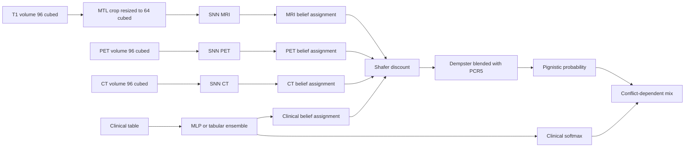

# What the code actually does

This note describes the system that `python main.py` runs. It follows the code in `config.py`, `MODULE/DSModule.py`, `MODULE/FusionModule.py`, and `MODULE/LossModule.py`. Older write-ups in `Methodology.md` and `DS_SNN_ConferencePaper.md` describe an earlier design.

The running model has four sources:

1. One medial-temporal crop of a registered T1 MRI, encoded by a 3D spiking network.
2. A whole-volume PET (AV45 / PIB / FDG share one encoder), encoded by a second 3D spiking network.
3. A whole-volume CT, encoded by a third 3D spiking network.
4. A short clinical table. Default `CLINICAL_MODEL='ensemble'`: LightGBM, XGBoost, CatBoost, random forest, extra trees and an RBF-SVM, fit once per fold on train visits, then frozen. `CLINICAL_MODEL='mlp'` is the old jointly-trained MLP. Clinical-only ablation reports the ensemble probabilities.

Each present source becomes a Dempster–Shafer belief assignment over {CN, MCI, AD}. They are fused in order MRI → PET → CT → clinical. A missing PET or CT does not drop the visit: that encoder is skipped and a vacuous assignment (Dempster identity) is used instead. Extra MRI boxes (`whole`, `hippocampus`, `ventricles`, `amygdala`) stay commented out in `config.py`.

Default settings this note assumes: `ABLATION='full'`, `CONFLICT_RULE='pcr5'`, dataset OASIS-3. Ablations are `full` or a plus-separated subset of `mri`, `pet`, `ct`, `clinical`. Default `ABLATION` in `config.py` is `clinical` so a first run needs no processed volumes.

## Pipeline



1. **Load visits.** OASIS-3 joins the CDR sheet, demographics, FreeSurfer volumes, and one T1 per session (`Oasis3Module.py`). The nearest PET and CT within 365 days of that MR day are attached; they may be missing. A visit with no T1 path or no usable CDR is dropped.
2. **Label.** CDR 0 is CN (0). CDR 0.5 is MCI (1). Any other finite CDR is AD (2). CDR and MMSE are labels only.
3. **Split.** Subjects are stratified by the last kept visit's label. Clinical mean, standard deviation, and NaN fill are fit on the training subjects only.
4. **Train samples.** Every kept visit by default (`train_visits='all'`). Validation and test always use the last visit.
5. **Forward.** `DSSNMMF.forward` encodes every active source that is present on the visit, fuses them, and returns `decision`.
6. **Test.** Metrics use `decision`. A missing clinical number is replaced by the training mean. Missing PET or CT uses a vacuous belief assignment.

## Sources

MRI is off when `mri` is not in the ablation. The T1 file still has to exist so the visit is kept. PET and CT encoders are separate SNNs on a whole-volume 64³ resize. A 4D PET series is collapsed to the mean of its last third of frames at preprocess time. CT is not skull-stripped.

Clinical columns: Age, EDUC, MF, eTIV, nWBV. Off when clinical is not in the ablation.

Evidence caps: MRI/PET/CT scale 0.7, cap 9 in the full model and 18 standalone. Clinical cap 18. Reliabilities: `mtl` 0.90, PET 0.90, CT 0.80, clinical 1.0. A sample is discounted only when two or more sources are actually present.

## Running

Training reads `data/oasis3/processed_v5/<session>/tensor_96x96x96.pt` for MRI, PET and CT session ids.

```bash
python -m OtherModules.mri_preprocess --modality mri --limit 1 --chunk 1 --workers 1 --force
python main.py --folds 2 --single-split
python main.py --ablation mri+pet+clinical
python main.py --clinical-model mlp
```

`--ablation clinical` skips volume reads and still requires the T1 paths and the three tables, because visits without a T1 are dropped.
